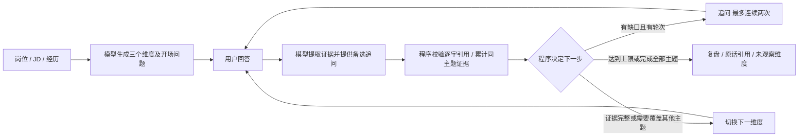

# 面试练习室 · Interview Agent

基于 Java 21 / Spring Boot 3.5 的个人文字面试应用。同一个服务提供网页和 API，无需 Node.js、Nginx 或数据库。

## 功能

- 输入个人经历和目标岗位 JD，生成面试准备清单。
- 逐题教练或连续追问模式，支持中文、英文，最多 4/6/8 轮面试。
- 开始前生成三个考察维度；每个主题最多连续追问两次，并为尚未考察的主题保留轮次。
- 回答后提取背景、个人行动、决策取舍、结果依据；原文引用校验通过后才计入证据。
- 基于回答生成复盘，导出 Markdown；浏览器本地保存草稿和历史。
- 不调用模型的流程演示。
- 个人账号登录、CSRF 防护、输入长度限制及模型输出结构校验。
- 支持 OpenAI Responses、兼容 Chat Completions 的 JSON Schema 接口，以及 DeepSeek 官方 JSON 模式。

## 本地运行

需要 JDK 21 和 Maven 3.9+。

```bash
mvn clean verify
# bash / zsh：交互输入密码，避免写入命令历史。
printf '输入登录密码（16～64 位英文、数字、符号）：'
read -rs APP_PASSWORD
export APP_PASSWORD
export SESSION_COOKIE_SECURE=false
java -jar target/interview-agent.jar
```

打开 http://localhost:8080，用户名默认为 `owner`。没有配置模型密钥时也可体验演示。

`.env.example` 是环境变量清单，程序不会自动加载 `.env`；请在运行进程或部署平台中设置。

## 配置

| 变量 | 用途 |
|---|---|
| `APP_USERNAME` | 登录用户名，默认 `owner` |
| `APP_PASSWORD` | 必填；16～64 位英文、数字、符号密码；未设置则拒绝启动 |
| `PORT` | 默认 `8080` |
| `SESSION_COOKIE_SECURE` | 默认 `true`；本地 HTTP 开发设为 `false`，公网使用 HTTPS |
| `OPENAI_API_KEY` | 所选模型供应商的 API Key；仅保存在服务端 |
| `OPENAI_MODEL` | 模型 ID |
| `AI_API_MODE` | `responses` 或 `chat` |
| `OPENAI_BASE_URL` | API 根地址，不包含 `/responses` 或 `/chat/completions` 后缀 |

### DeepSeek 官方接口

```text
OPENAI_BASE_URL=https://api.deepseek.com
OPENAI_MODEL=deepseek-flash
AI_API_MODE=chat
```

另外设置你自己的 `OPENAI_API_KEY`。程序针对 DeepSeek 官方地址使用 `json_object`，在系统提示中提供完整输出 schema，并在返回后严格校验。关闭 thinking 模式以适配交互式面试；单次模型请求超时 45 秒。

其他 Chat Completions 网关默认使用 `response_format.json_schema`；Responses 接口使用 `text.format.json_schema`。模型与网关必须支持对应格式。

## 微信云托管 / Docker 部署

1. 在云托管服务中选择仓库源码部署，构建上下文为根目录，Dockerfile 路径为 `Dockerfile`。
2. 服务监听端口设置为 `8080`，与应用和 Dockerfile 一致。
3. 设置 `APP_PASSWORD` 及模型相关环境变量。本仓库没有内置登录密码或模型密钥。
4. 个人版使用单实例，最大实例数也设为 1；登录会话保存在内存，重启或发布新版本后需重新登录。
5. 若配置 HTTP 健康检查，使用 `/healthz` 和端口 `8080`；该接口不需要登录。
6. 发布成功后通过 HTTPS 访问，登录并发起一次真实 AI 面试验证连接。状态“AI 已配置”仅表示读取到了配置。

Dockerfile 使用多阶段构建：运行测试并生成 JAR，再放入 Java 21 运行时镜像。模型密钥和登录密码通过运行时环境变量注入，不要写进 Dockerfile 或提交到 Git。

若模型返回 402，请检查供应商账户余额；401 检查密钥；超时检查云端网络和模型延迟。默认公网域名用于测试，长期使用请按平台要求绑定自定义域名。

## 代码与验证

- `SecurityConfig`：登录、会话、CSRF 和 CSP。
- `ApiController`：健康检查、配置状态与面试 API。
- `Contracts`：输入和输出结构校验。
- `AgentService`：供应商适配、超时、并发限制与错误处理。
- `InterviewWorkflow`：面试计划、累计证据、追问/换题/结束规则与复盘引用校验。
- `src/main/resources/static`：原生 HTML/CSS/JavaScript 网页。
- `src/main/resources/*-prompt.txt` / `*-schema.json`：准备、计划、证据提取、复盘及旧版任务的提示词和结构定义。

运行 `mvn verify` 执行 24 项测试，覆盖登录、安全边界、输入校验、模型请求格式、异常输出、DeepSeek 适配、主题覆盖、追问上限、重复问题、跨轮累计证据、虚构引用、提前复盘和旧版接口。模型单元测试使用本地模拟服务，不消耗真实模型额度。

## v0.2 面试流程



网页仍使用 `POST /api/agent`，新增操作：

- `plan`：一次模型调用生成计划和首题。
- `step`：提交回答，一次模型调用提取证据和备选追问，再由代码选题或结束。最后一轮也会分析。失败时不提交本地对话变更，保留草稿供重试。
- `review_v2`：根据计划、对话和证据生成复盘，强制列出全部维度；未经考察或无有效证据的维度为「未观察」。

`step` / `review_v2` 附带 `workflow: {plan, turns, analyses}`。状态保存在浏览器，服务端检查维度、对话顺序、分析数量及引用对应关系，并从记录重新计算进度。它是个人练习数据，不是具有防篡改保证的招聘测评记录。

同一主题的多轮证据会合并用于决定是否继续追问。所有主题结束后可以少于设定上限结束，避免为凑轮数重复提问。教练模式可展开每轮证据；连续追问模式中途不展示分析。

复盘的「充分 / 部分 / 未观察」表示四类回答信息的覆盖程度，不是能力评分。引用使用实际回答的原文和轮次；优点、改进建议必须附有该维度的已验证引用。原文匹配不能证明事实为真、理解准确或建议必然成立；回答改写仍需人工核对，未知事实应标记待补充。

旧浏览器记录与正在进行的 v1 面试继续走旧接口；升级后新开始的正式面试使用 v2。固定问题的演示流程保持独立，不使用模型或做能力判断。

`src/test/resources/interview-regressions.json` 是固定回归样例，包含模糊团队贡献、完整经历、模型虚构数字和拼接引用。这些测试验证程序规则与输出约束，使用模拟模型，不代表真实模型的语义质量评估。

## 数据与使用范围

第一版用于个人练习，没有多用户账号、云端记录同步或微信消息接入。资料、对话和复盘保存在当前域名、当前浏览器的 localStorage；更换设备或域名不会自动迁移。退出登录不清除浏览器资料，重要复盘请导出。

真实 AI 请求会将当次素材和历史对话发送给配置的供应商。应用不主动将这些内容写入数据库或日志。模型反馈可能有误，仅用于练习；缺少事实时提示词要求标记待补充，不捏造经历和数据。

## 官方资料

- [DeepSeek API](https://api-docs.deepseek.com/zh-cn/)
- [微信云托管 Spring Boot 模板](https://github.com/WeixinCloud/wxcloudrun-springboot)
- [Spring Boot 3.5](https://docs.spring.io/spring-boot/3.5/)
